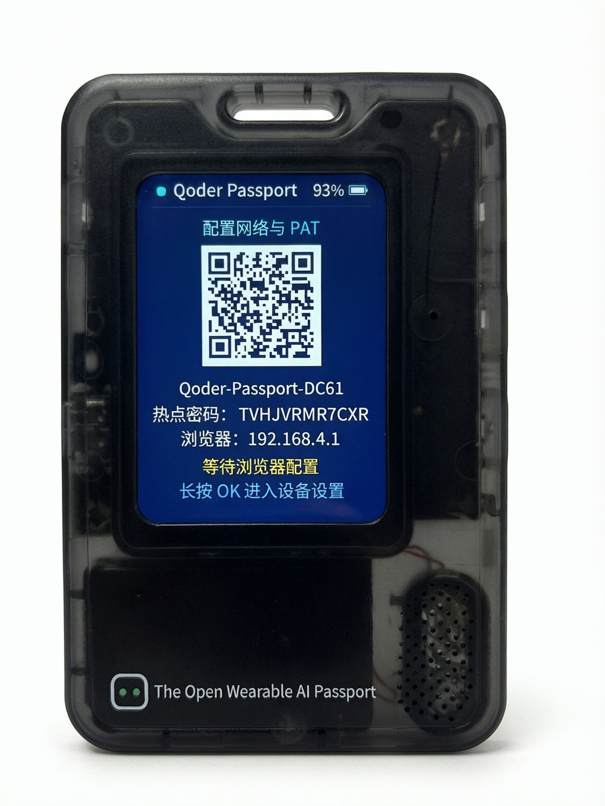
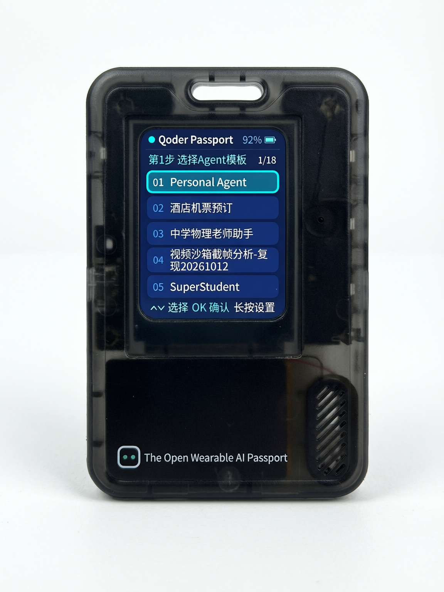
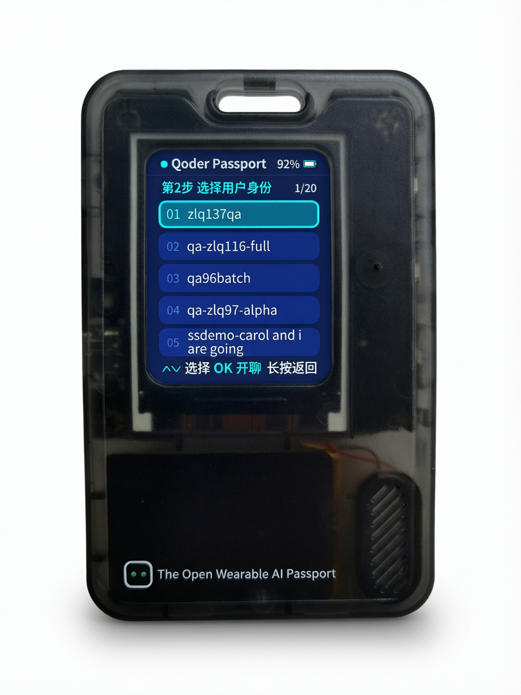
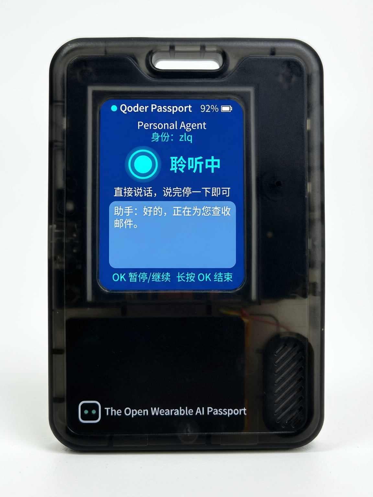

**English** · [简体中文](README.zh_CN.md)

# Qoder-Passport

A full-duplex voice companion that runs on the **FoloToy AI Passport** wearable
(ESP32-C3) and talks to **Qoder Cloud Agents (QCA)**. Pick an Agent template and
a user identity with three physical buttons, then hold a real-time, barge-in
capable spoken conversation over a WebSocket to `api.qoder.com`.

Wi-Fi credentials and the QCA Personal Access Token are entered on the device's
own captive web portal at `192.168.4.1`. Nothing secret is compiled into the
firmware.

| | |
| --- | --- |
| Project name | `Qoder-Passport` |
| Current version | **v0.1.0** |
| Target hardware | FoloToy AI Passport (ESP32-C3, 8 MB Flash, no PSRAM) |
| Toolchain | ESP-IDF **v5.5.3**, target `esp32c3` |
| Cloud backend | Qoder Cloud Agents — `https://api.qoder.com/api/v1`, `wss://api.qoder.com/api/v1/forward/realtime` |
| License | MIT (derived from [FoloToy/ai-passport](https://github.com/FoloToy/ai-passport)) |

> [!NOTE]
> This repository is a derivative application built on the FoloToy AI Passport
> open hardware platform. The board support package under `components/bsp`, the
> hardware documentation under `docs/hardware-design/`, and the build gate under
> `tools/` come from upstream and are retained under the original MIT license and
> copyright notice in [LICENSE](LICENSE). The application in `main/` — screens,
> state machines, Wi-Fi provisioning portal, QCA integration, and audio pipeline
> — is original work for this project.

---

## On-device screens

Four captures of the shipped v0.1.0 interface in first-run order: the
configuration hotspot, the two selection steps, and a live voice session.
The hotspot name and password on the first screen are generated fresh by the
device for every provisioning session.

| 1 — Configuration hotspot | 2 — Step 1: pick an Agent template |
| :---: | :---: |
|  |  |

| 3 — Step 2: pick a user identity | 4 — Live voice session |
| :---: | :---: |
|  |  |

## What it does

1. Boots, restores saved Wi-Fi credentials, and joins your 2.4 GHz network.
2. Lists your **Agent templates** from Qoder Cloud Agents (step 1 on screen).
3. Lists your **user identities** (step 2 on screen).
4. Opens a realtime voice session: you speak, the agent speaks back, and either
   side can interrupt. Downlink audio is 24 kHz PCM streamed as base64 over the
   WebSocket; uplink is microphone PCM with on-device gain and clipping control.
5. Shows a live status word (connecting, listening, thinking, answering, paused,
   ended, error) plus a scrolling transcription line, and lets you change volume
   without leaving the conversation.

If no network or no PAT is present, the device starts its own WPA2 configuration
hotspot instead and shows a QR code, the temporary password, and the portal URL.

## Hardware

FoloToy AI Passport, 60 x 95 x 8.5 mm wearable, 50 g.

| Subsystem | Part | Interface |
| --- | --- | --- |
| MCU | ESP32-C3, 8 MB Flash, **no PSRAM** | — |
| Display | ST7789P3, 240 x 320, RGB565 | SPI2 @ 80 MHz, mode 0 |
| Backlight | LCD LED | GPIO21, LEDC 5 kHz / 10-bit |
| Input | UP / DOWN / OK resistor ladder | GPIO0 (ADC1_CH0), external 10 kΩ pull-up |
| Audio | ES8311 codec, built-in mic and speaker | I2S0 full duplex + shared I2C |
| Battery | 500 mAh Li-ion with CW2017 fuel gauge | I2C0, address `0x63` |
| Console | USB Serial/JTAG | GPIO18/19, **115200 baud** |
| Charging | USB Type-C 2.0, 5 V | — |
| Wireless | 2.4 GHz Wi-Fi 802.11 b/g/n | station mode (BLE is disabled in this build) |

Complete pin map, bus ownership, timing constants, and known gotchas:
[hardware development guide](docs/hardware-design/AI_HARDWARE_DEVELOPMENT_GUIDE.md)
and [product specifications](docs/hardware-design/specifications.md).

Two hardware facts shape this firmware:

- **No PSRAM.** Every byte of the TLS record buffer, the audio pipeline, LVGL,
  and the Wi-Fi stack comes out of the same ~400 KB SRAM. The memory strategy in
  [sdkconfig.defaults](sdkconfig.defaults) and `main/tls_mfl.c` exists because of
  this and must not be relaxed casually.
- **GPIO21 is the backlight.** The console therefore stays on USB Serial/JTAG.
  Switching to UART0 would drive the backlight pin as TX.

## Get started

Full end-user walkthrough: [getting started](docs/usage/getting-started.md).

You need a Qoder account with a **Personal Access Token**, and a 2.4 GHz Wi-Fi
network. The token is created in your Qoder account settings; the device only
ever stores it in its own NVS and never logs it.

### Option A — flash a prebuilt release

Download `Qoder-Passport-<version>-esp32c3-full.bin` from this repository's
GitHub **Releases** page and write it at offset `0x0`:

```bash
python -m esptool --chip esp32c3 -p <PORT> -b 460800 \
  write_flash 0x0 Qoder-Passport-v0.1.0-esp32c3-full.bin
```

The merged image pads the gaps between the bootloader, partition table, and
application, so writing it at `0x0` **resets the NVS and PHY regions** — any
stored Wi-Fi credentials, PAT, and volume are erased. That is the right choice
for a blank device or an intentional clean install. To upgrade while keeping
stored settings, use the segmented write described in
[firmware layout and flashing policy](docs/development/engineering/firmware-layout.md).

### Option B — build from source

```bash
git clone <this-repo> Qoder-Passport && cd Qoder-Passport
# Install ESP-IDF v5.5.3 for esp32c3 first; see the environment guide.
source <path-to-esp-idf-v5.5.3>/export.sh
idf.py --version                 # must print exactly ESP-IDF v5.5.3
./tools/validate.sh --firmware   # build + verify merged image + archive
```

The gate writes `build/FoloToy-AI-Passport-full.bin` (the merged image, flash at
`0x0`) and a content-addressed debug bundle under
`build/firmware/<full-bin-sha256>/` containing the ELF, MAP, component images,
`manifest.json`, and `flash_args`. The internal CMake project name is still
`FoloToy-AI-Passport` for continuity with upstream tooling; releases rename the
asset to `Qoder-Passport-<tag>-esp32c3-full.bin`.

Environment bootstrap, host OS packages, mainland-China mirrors, and toolchain
repair: [environment setup](docs/development/engineering/environment-setup.md).
Build and gate details: [build and test](docs/development/engineering/build-and-test.md).

## First run

1. Power on (hold the hardware power button about 0.5 s).
2. With no saved network, the screen shows **provisioning**: a QR code, the
   hotspot SSID, and a temporary WPA2 password.
3. Join that hotspot from a phone or laptop, open `http://192.168.4.1`.
4. The page scans for networks. Pick yours (hidden SSIDs can be typed manually),
   enter the Wi-Fi password, and paste your Qoder PAT.
5. Save. The device verifies the PAT against the QCA API **before** persisting
   anything, connects, then reboots into normal mode.
6. Step 1: choose an Agent template. Step 2: choose a user identity. Talk.

Settings are reachable by long-pressing **OK** on the template screen, the
provisioning screen, or any network/PAT error screen. From there you can refresh
the lists, re-run provisioning, or factory-reset. Factory reset asks twice and
defaults to **Cancel**; confirming still requires a long press.

## Button reference

| Input | In a list | On the voice screen | On an error screen |
| --- | --- | --- | --- |
| UP / DOWN click | move selection by 1 | volume +10 / -10 | — |
| UP / DOWN double click | move by 2 | volume +10 / -10 | — |
| UP / DOWN long press | move by one page (5) | volume +10 / -10 | — |
| OK click | confirm | pause / resume | retry |
| OK long press | device settings (template screen) · go back (identity screen) | end the conversation | device settings or back |

Short press is 180 ms, long press is 500 ms. Button callbacks only enqueue
events; all blocking work happens on the application task.

## Software stack and versions

Pinned by [dependencies.lock](dependencies.lock); do not edit `managed_components/`.

| Component | Version | Used for |
| --- | --- | --- |
| ESP-IDF | 5.5.3 | SDK and toolchain |
| `lvgl/lvgl` | 9.6.0~1 | UI rendering |
| `espressif/esp_lvgl_port` | 2.9.0 | LVGL task and display plumbing |
| `espressif/esp_codec_dev` | 1.6.2 | ES8311 audio |
| `espressif/esp_websocket_client` | 1.8.0 | QCA realtime voice channel |
| `espressif/button` | 4.2.0 | three-button ADC ladder |
| `espressif/cmake_utilities` | 1.1.1 | component build helpers |
| `components/bsp` | vendored in-repo | board support: display, audio, battery, buttons, I2C |

Direct manifest dependency added by this project: `espressif/esp_websocket_client ^1.5.0`
(see [main/idf_component.yml](main/idf_component.yml)).

Key build configuration in [sdkconfig.defaults](sdkconfig.defaults): 8 MB Flash
with a fixed image header, custom three-entry
[partition table](partitions.csv), USB Serial/JTAG console, Bluetooth disabled,
`LV_MEM_SIZE=32768`, mbedTLS static buffers with RFC 6066 max-fragment-length
negotiation (4 KB out / 8 KB in), 8 KB TCP window, and Wi-Fi IRAM optimisation
turned off to return ~25 KB to the heap. Each setting carries a comment
explaining the measured failure that motivated it.

Full rationale, deployment requirements, and reproduction steps:
[Qoder-Passport stack](docs/development/engineering/qoder-passport-stack.md).

## Repository layout

| Path | Contents |
| --- | --- |
| `main/` | The Qoder-Passport application: UI, Wi-Fi, portal, QCA API, voice, audio DSP |
| `main/portal.html` | The captive configuration portal (embedded into the firmware) |
| `components/bsp/` | Board support package from upstream |
| `assets/fonts/` | Generated LVGL fonts: GB2312 16 px body text, 28 px status words |
| `tests/` | Host tests: pure-logic C suites and source-contract Python suites |
| `tools/` | `validate.sh` gate, firmware verification, archive tooling, repo checks |
| `docs/` | Hardware, engineering, CI, release, and reference documentation |
| `skills/` | Agent skills for develop / setup / build / device-test / debug workflows |
| `main/demo_*.c` | Upstream hardware-test demos, kept for reference, **not compiled in** |

## Testing

```bash
./tools/validate.sh --static     # repo conventions, workflows, host C and Python tests
./tools/validate.sh --firmware   # ESP-IDF build, merge-bin, layout validation
./tools/validate.sh              # complete gate (needs an activated ESP-IDF)
```

`--static` needs Python 3, a host C compiler, `curl`, `tar`, and a SHA-256 tool.
The C suites cover the list/window cursor, key debouncing, JSON streaming,
base64 streaming, audio DSP, voice state machine, UTF-8 helpers, portal form
parsing, and BSP display/audio/button logic. The Python suites are
source-contract regressions: they pin invariants such as "Wi-Fi passwords are
never passed to a log format string" and "the credential mirror is written
before the best-effort driver flash write".

A passing build is **not** hardware acceptance. On-device results are reported
separately in each release note.

## Release

- Release notes: [v0.1.0](docs/development/release/v0.1.0.md)
- CI: pushing a tag runs
  [.github/workflows/build-firmware.yml](.github/workflows/build-firmware.yml),
  which builds with ESP-IDF v5.5.3 for `esp32c3` through the same gate and
  publishes a GitHub Release. Pull requests and pushes to `main` run the
  firmware and static check workflows.
- Changelog: this project records release detail under
  `docs/development/release/`. The upstream [docs/CHANGELOG.md](docs/CHANGELOG.md)
  is reserved for the upstream platform history.

## Security and privacy

- The QCA PAT and the Wi-Fi password are stored in the device's NVS
  (`qca_app` namespace) and are entered only through the local portal. Neither
  is compiled into the firmware: `main/qca_secrets.h` is git-ignored and is not
  included by any translation unit.
- No log line ever prints an SSID, a password, or a PAT. Credential paths log
  only lengths and `esp_err_t` names, and `tools/check_repo.py` plus the Python
  contract tests enforce this.
- The configuration hotspot uses WPA2 with a random per-session password, not an
  open network. Portal writes require a per-session CSRF token and are rejected
  unless the request originates from the AP interface.
- TLS certificate validation and cipher suites are unchanged from ESP-IDF
  defaults. The memory tuning reduces buffer sizes; it does not weaken crypto.
- Factory reset removes Wi-Fi credentials, the PAT, the volume setting, and the
  provisioning flag. It does not erase the whole chip and does not delete
  server-side conversations.

## Known limitations in v0.1.0

- Only one Wi-Fi network is remembered. There is no on-device multi-network
  manager; changing networks means re-running the portal.
- The channel hint used to speed up boot association is learned at runtime and
  stored in NVS. If it goes stale the driver still scans onward from it, so a
  stale hint costs time, never connectivity.
- If the saved network is not visible at boot, the device retries for about 21 s
  and then falls back to the configuration hotspot. This is intentional but can
  surprise users whose router is briefly offline.
- No OTA. Updates require a USB flash.
- The 6.2 MB generated CJK font source is committed so that a checkout builds
  without a font toolchain. Regeneration needs `fonttools`, Node.js with
  `lv_font_conv@1.5.3`, and a Noto Sans SC variable font; see
  [assets/fonts/build_fonts.py](assets/fonts/build_fonts.py) and
  [Chinese font guide](docs/development/engineering/lvgl-chinese-fonts.md).

## Contributing

Read [CONTRIBUTING](.github/CONTRIBUTING.md), the
[commit and PR conventions](docs/contribution/commit-and-pr.md), and the
[documentation conventions](docs/contribution/doc-conventions.md). Every
maintained Markdown document needs an English `.md` and a Simplified Chinese
`.zh_CN.md` peer with reciprocal language links; `tools/check_repo.py` enforces
this in CI.

Agent-assisted development: start from [AGENTS.md](AGENTS.md) and the
[AI development guide](docs/development/ai-guide.md).

## License

MIT. See [LICENSE](LICENSE). Copyright (c) 2026 FoloToy for the upstream
platform; this derivative application is distributed under the same terms.
